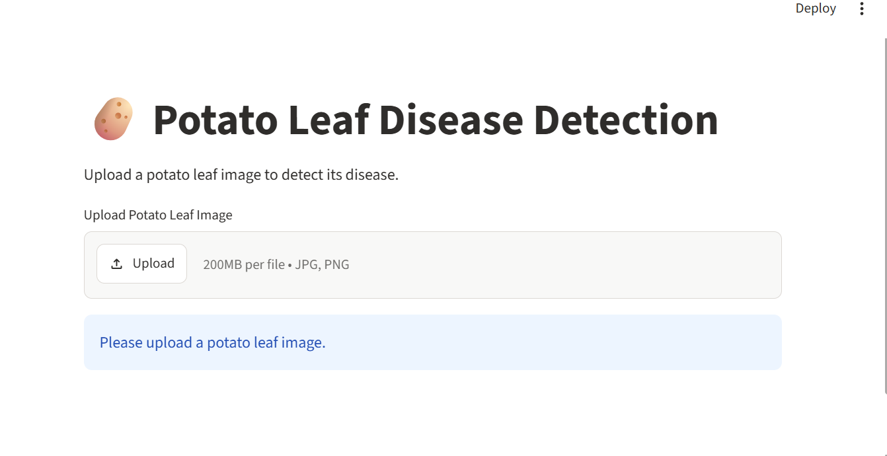
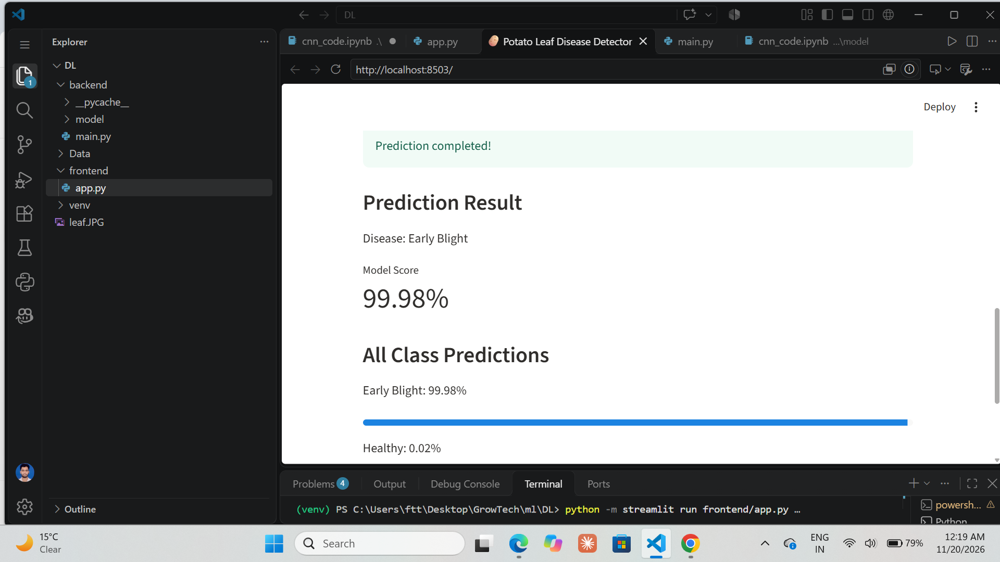

# 🥔 Potato Leaf Disease Detection Using CNN

An end-to-end deep learning web application that classifies potato leaf images into three categories using a Convolutional Neural Network (CNN).

The application uses **TensorFlow/Keras** for deep learning, **FastAPI** for backend REST API development, and **Streamlit** for the interactive frontend.

## Features

- Upload potato leaf images in JPG, JPEG, or PNG format.
- Classify images into Early Blight, Late Blight, or Healthy.
- Display predicted disease and model confidence.
- View confidence scores for all three classes.
- Send images from Streamlit to FastAPI for model inference.

## Technologies Used

| Technology | Purpose |
|---|---|
| Python | Core programming |
| TensorFlow / Keras | CNN model training and inference |
| FastAPI | REST API backend |
| Streamlit | Web frontend |
| NumPy | Image array processing |
| Pillow | Image preprocessing |
| Requests | Frontend-to-backend communication |

## Project Structure

```text
backend/
    main.py
    model/
        potato_cnn_model.keras
        cnn_code.ipynb
        classification_report.txt

frontend/
    app.py

screenshots/
    homepage.png
    prediction.png

requirements.txt
README.md
```

## How It Works

1. The user uploads a potato leaf image through Streamlit.
2. Streamlit sends the image to FastAPI using an HTTP POST request.
3. FastAPI preprocesses the image and passes it to the trained CNN model.
4. The CNN generates prediction probabilities.
5. FastAPI returns the results as JSON.
6. Streamlit displays the predicted class and confidence score.

## Installation

Clone the repository:

```bash
git clone https://github.com/YOUR_USERNAME/Potato-Leaf-Disease-Detection.git
cd Potato-Leaf-Disease-Detection
```

Create and activate a virtual environment:

```powershell
python -m venv venv
.\venv\Scripts\Activate.ps1
```

Install dependencies:

```bash
python -m pip install -r requirements.txt
```

## Run the Application

Start FastAPI:

```bash
python -m uvicorn backend.main:app --reload
```

Open a second terminal and start Streamlit:

```bash
python -m streamlit run frontend/app.py
```

Open the local URL displayed by Streamlit.

FastAPI documentation is available at:

http://127.0.0.1:8000/docs

## Screenshots

### Application Interface



### Disease Prediction



## Model Evaluation

The CNN model was trained to classify three potato leaf categories.

Evaluation metrics are available in `backend/model/classification_report.txt`.

A high confidence score for an individual prediction does not necessarily indicate high overall model accuracy.

## Future Improvements

- Improve model generalization using data augmentation.
- Add more plant disease categories.
- Deploy the application online.
- Add prediction history and logging.

## Author

**Aman Kushwaha**

Python Developer | AI/ML | Data Analytics


## Live Demo

Try the Potato Leaf Disease Detection application online:

[Launch Live Application](https://potato-leaf-disease-detection-zjl8fv7znk2on2yrefaqgw.streamlit.app/)

## API Documentation

[FastAPI Swagger UI](https://potato-leaf-disease-detection-3x8q.onrender.com/docs)